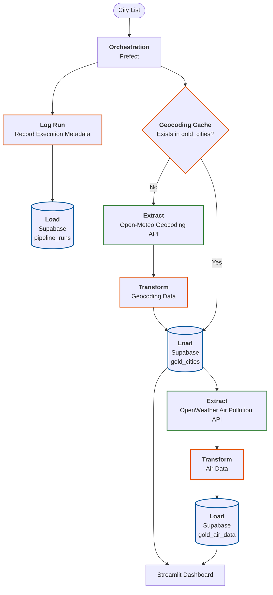
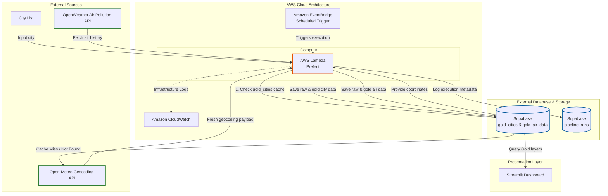

# City Air Tracker - System Architecture & Plan

This document outlines the system architecture and data flow for the **City Air Tracker** project, detailing how data moves from input through raw and gold PostgreSQL storage, powers the Streamlit dashboard, and maps to an eventual AWS cloud deployment.

## System Architecture Diagram

The diagram below illustrates the major local components and connections of the system:

## Component Breakdown

1. **City List:**
   List of target global cities.

2. **Orchestration**
   Coordinates the execution sequence from ingestion to transformation, via Prefect.

3. **Logging**
   Tracks and records execution metadata (such as run status, timestamps, and execution details) for every pipeline run into the pipeline_runs table for auditing and monitoring.

4. **Geocoding Cache**
   Prevents redundant external calls by saving resolved latitude and longitude values.

5. **Data Source and Extract**
- **OpenMeteo API:** Feeds raw geocoding, population and elevation data.
   - **OpenWeather API:** Feeds raw historical air pollution data.
   - **Extraction:** Queries APIs and captures raw responses.

6. **Raw Storage**
   - **Supabase:** Stores immutable, raw response records before any data cleaning.

7. **`Transform and Gold Storage**
   - **Transformation Logic:** Cleans, parses, and structures raw records.
   - **Gold Dataset:** Normalized or aggregated tables in Supabase for downstream consumption.

8. **Dashboard**
   - **Streamlit Dashboard:** Displays historical air quality metrics, interactive charts, and city trends.

## Eventual AWS Deployment

The following diagram illustrates the system transitioned to an eventual AWS deployment:

### AWS Deployment Components

- **Database:** Supabase, housing raw data, gold data, and audit tables.
- **Compute & Orchestration:** Serverless batch pipeline running on **AWS Lambda**, triggered on a schedule by **Amazon EventBridge**, executing the Prefect with cache-aside geocoding logic.
- **App Hosting:** **Amazon EC2 / S3 / ECS** to host and run the interactive Streamlit dashboard application.
- **Observability:** Pipeline execution logs, metrics, and error monitoring managed through **Amazon CloudWatch**.