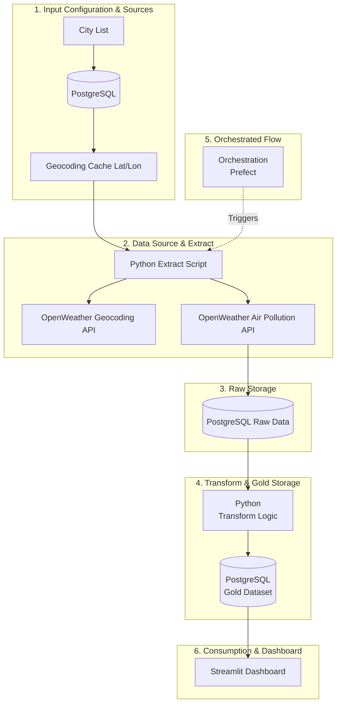
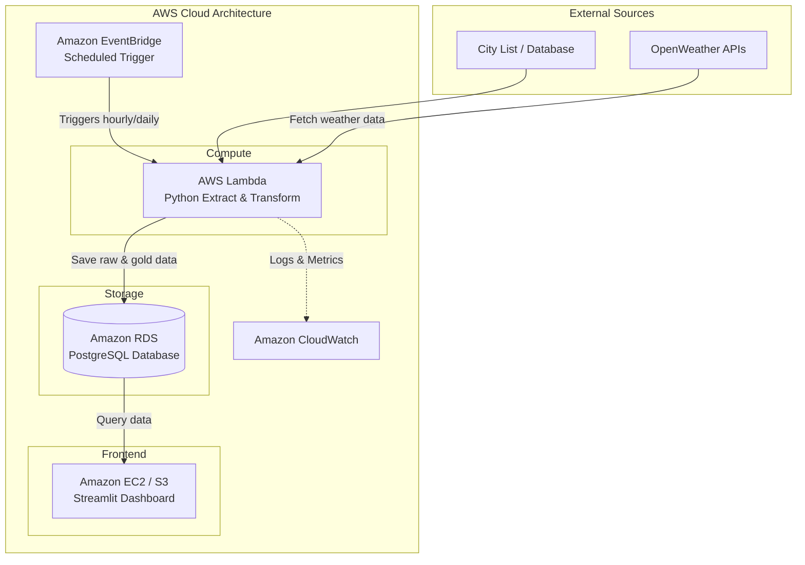

# City Air Tracker - System Architecture & Plan

This document outlines the system architecture and data flow for the **City Air Tracker** project, detailing how data moves from input through raw and gold PostgreSQL storage, powers the Streamlit dashboard, and maps to an eventual AWS cloud deployment.

## System Architecture Diagram

The diagram below illustrates the major local components and connections of the system:

## Component Breakdown

1. **Input Configuration**
   - **City List:** List of target global cities stored as runtime state.
   - **Geocoding Cache:** Prevents redundant external calls by saving resolved latitude and longitude values in PostgreSQL.

2. **Data Source and `extract()`**
   - **OpenWeather APIs:** Feeds raw location and historical air pollution data.
   - **Python Extractor:** Queries APIs and captures raw responses.

3. **Raw Storage**
   - **PostgreSQL Raw Tables:** Stores immutable, raw response records before any data cleaning.

4. **`transform()` and Gold Storage**
   - **Transformation Logic:** Cleans, parses, and structures raw records.
   - **Gold Dataset:** Normalized or aggregated tables in PostgreSQL for downstream consumption.

5. **Orchestrated Flow**
   - **Orchestration:** Coordinates the execution sequence from ingestion to transformation, via Prefect.

6. **Dashboard**
   - **Streamlit Dashboard:** Displays historical air quality metrics, interactive charts, and city trends.

## Eventual AWS Deployment

The following diagram illustrates the system transitioned to an eventual AWS deployment:

### AWS Deployment Components

- **Database:** Transition from local PostgreSQL to **Amazon RDS for PostgreSQL**.
- **Compute & Orchestration:** Serverless batch pipeline running on **AWS Lambda**, triggered on a schedule by **Amazon EventBridge**.
- **App Hosting:** **Amazon EC2 / S3 / ECS** to host and run the interactive Streamlit dashboard application.
- **Observability:** Pipeline execution logs, metrics, and error monitoring managed through **Amazon CloudWatch**.